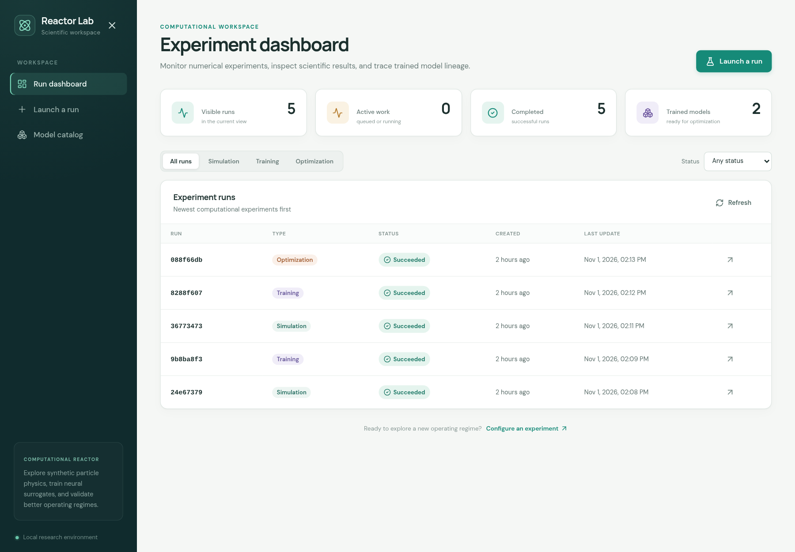
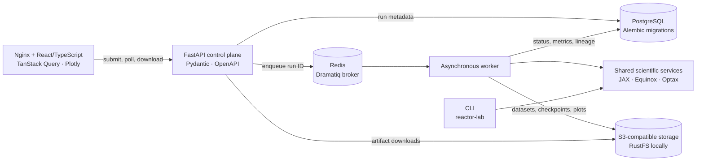
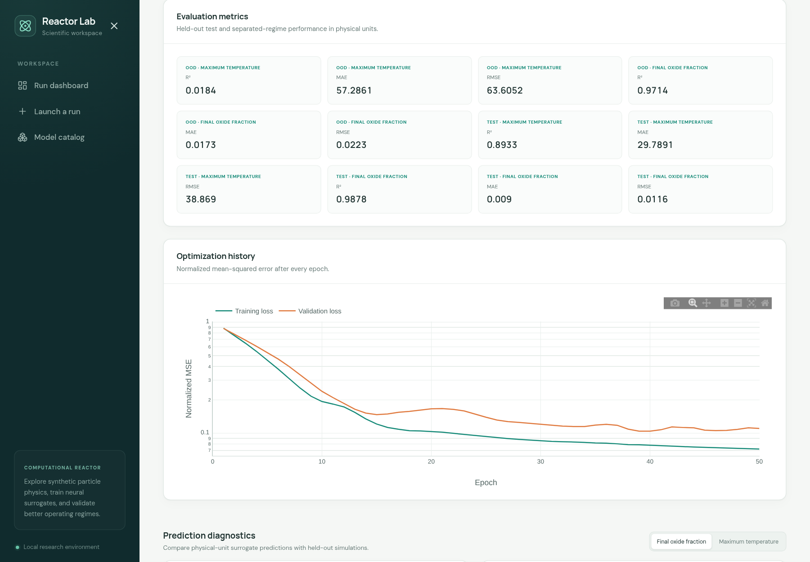

# Reactor Lab

[](https://github.com/sgillis/reactor_lab/actions/workflows/ci.yml)

Reactor Lab is an end-to-end simulation and machine-learning platform built around a reduced-order particle-reactor model. It combines JAX-based physics, Equinox/Optax surrogate training, constrained operating-condition search, and a React web interface backed by asynchronous workers.

The repository demonstrates the complete path from numerical model to usable platform: typed configuration, reproducible data generation, held-out evaluation, model lineage, persistent artifacts, interactive visualization, and automated checks.

> **Scope:** all data and results are synthetic. This is a systems and scientific-ML project, not a quantitatively validated plasma-reactor model.



## Highlights

- **Scientific computing:** immutable, validated configurations; fixed-step particle dynamics; JAX `jit` and `vmap` execution; trajectory and summary outputs.
- **Machine learning:** seeded synthetic datasets, an Equinox MLP trained with Optax, training-set-only normalization, self-contained checkpoints, and reload-time evaluation.
- **Evaluation beyond a random split:** held-out test metrics plus a separated high-temperature regime, with MAE, RMSE, R², parity plots, and residual diagnostics.
- **Constrained optimization:** reproducible candidate sampling, surrogate screening, ranking by an explicitly labelled energy proxy, and final validation with the physics simulator.
- **Production-shaped architecture:** FastAPI, Dramatiq workers, Redis, PostgreSQL/Alembic, S3-compatible artifact storage, and a React/TypeScript frontend with generated API types and Plotly charts.
- **Reproducibility and CI:** locked Python and Node dependencies, automated tests, static type checking, generated-contract drift checks, frontend builds, and an installed-CLI smoke workflow.

## Quickstart: web platform

Prerequisite: Docker with the Compose plugin.

```bash
docker compose up --build
# equivalent: make platform
```

Open **http://localhost:8080**. Select **Launch a run** to submit a simulation, surrogate-training job, or optimization. The dashboard tracks queued and completed work; run pages expose configurations, metrics, interactive plots, model lineage, and downloadable artifacts.

Other local endpoints:

- API and interactive OpenAPI docs: **http://localhost:8000/docs**
- RustFS object-store console: **http://localhost:9001** (`minioadmin` / `minioadmin` in the local Compose configuration)

The API applies Alembic migrations on startup. PostgreSQL, Redis, and RustFS use named volumes, so stopping the stack preserves local run data:

```bash
docker compose down
# equivalent: make platform-down
```

The Compose stack is an unauthenticated, localhost-only development environment; it is not a hardened multi-user deployment.

## CLI quickstart

The same scientific workflows are available without Docker. Install [uv](https://docs.astral.sh/uv/), then run:

```bash
uv sync --locked --all-groups
uv run reactor-lab run-demo
```

The demo generates synthetic data, trains and reloads a surrogate, evaluates both test regimes, optimizes candidate conditions, and validates recommendations with the simulator. Outputs are written to `artifacts/demo/`, including the complete replayable `run-config.json`.

```bash
uv run reactor-lab --help
uv run reactor-lab simulate --plot
uv run reactor-lab train
uv run reactor-lab optimize --model-directory artifacts/surrogate-training
```

## Architecture



The CLI and workers call the same application services, so delivery adapters do not duplicate scientific workflows. The API validates requests, persists run metadata, and returns `202 Accepted`; compute runs outside web-request processes. PostgreSQL stores searchable state and model lineage, while large immutable artifacts live in object storage.

## Scientific workflow

1. **Simulate** particle heating and oxide reduction under a typed reactor and particle configuration.
2. **Generate** reproducible synthetic datasets with saved sampling bounds, split assignments, feature ordering, and seeds.
3. **Train** a two-output surrogate for final oxide fraction and maximum particle temperature.
4. **Evaluate** on unseen in-distribution samples and a separated 2,800–3,400 K peak-temperature regime; the training range ends at 2,800 K.
5. **Optimize** by screening and ranking surrogate predictions, then validating leading candidates with the simulator. A recommendation must satisfy both stages.



Peak gas-temperature setpoint is an **energy proxy**, not a physical energy-consumption calculation. Agreement with the toy simulator does not establish accuracy against experimental data, and separated-regime evaluation does not guarantee extrapolation reliability.

## Development and verification

```bash
# Backend tests and static type checking
uv sync --locked --all-groups
uv run pytest
uv run basedpyright .

# Frontend type checking and production build
npm --prefix frontend ci
npm --prefix frontend run typecheck
npm --prefix frontend run build
```

After changing the API, regenerate the OpenAPI document and TypeScript schema:

```bash
make frontend-generate
```

GitHub Actions runs on pushes to `main`, pull requests, and manual dispatch. CI checks the backend on Python 3.12 and the frontend on Node 22, verifies generated OpenAPI/TypeScript contracts are current, and smoke-tests the complete installed CLI workflow.

## Documentation

- [Physics, units, numerical method, and assumptions](docs/physics.md)
- [Printable model summary](docs/model-summary.pdf)
- [ADR 0001: Equinox and Optax](docs/adr/0001-use-equinox-and-optax.md)
- [ADR 0002: web and compute platform architecture](docs/adr/0002-adopt-production-platform-architecture.md)
- [ADR 0003: RustFS for local object storage](docs/adr/0003-use-rustfs-for-local-object-storage.md)

Non-goals include plasma CFD, detailed plasma chemistry, atomization, and claims based on real reactor data. Authentication, managed deployment, and cloud orchestration are intentionally outside the local demo configuration.
